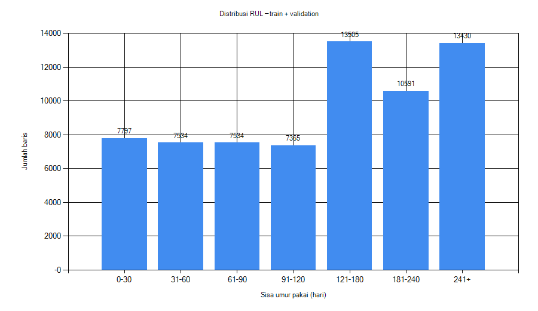
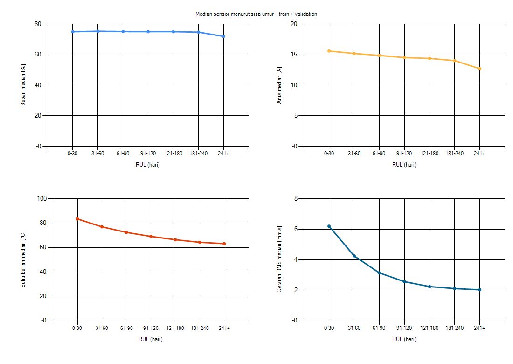

# Prediksi Sisa Umur Pakai Motor Induksi

**Tim:** [Nama tim] · **Anggota:** [Nama dan NIM]  
**Repositori:** [tautan GitHub] · **Aplikasi:** [tautan aplikasi] · **Video:** [tautan video]

## 1. Masalah dan pengguna

Manajer pemeliharaan mengelola motor pompa dan konveyor di tiga lokasi. Motor pengganti membutuhkan waktu pengiriman 2–4 minggu. Proyek ini membuat model regresi yang memperkirakan sisa umur pakai (RUL) motor dalam hari dari tipe motor dan enam pembacaan sensor. Prediksi membantu perencana menentukan waktu pemesanan dan prioritas inspeksi. Metrik utama adalah MAE pada baris dengan `rul_hari <= 60`, karena baris tersebut paling dekat dengan keputusan pemesanan; MAE seluruh baris juga dilaporkan.

## 2. Data dan pembersihan

CSV berisi 79.652 baris mentah, 11 kolom, dan 300 motor setelah normalisasi ID. Satu baris merepresentasikan satu motor pada satu hari. Terdapat 493 baris identik, 1.602 nilai arus kosong, 794 nilai suhu kosong, dan 241 nilai getaran RMS negatif. ID dinormalisasi dengan menghapus spasi/tanda baca dan menyeragamkan huruf. Baris duplikat identik dihapus. Label tipe motor dinormalisasi ke tiga kategori; label yang berubah dalam riwayat motor diperbaiki dengan tipe mayoritas per motor. Getaran negatif diperlakukan sebagai sensor hilang. Imputasi median dipelajari dari bagian train saja.

Sebanyak 2.923 pembacaan suhu melampaui 350°C. Nilai ini tidak dihapus otomatis karena dapat menunjukkan anomali atau fase kerusakan; aplikasinya memberi peringatan untuk memeriksanya. Beban di atas 100% juga dipertahankan sebagai kemungkinan kondisi beban lebih.

## 3. Metode

Data dibagi menurut motor dengan seed 42: 210 motor untuk train, 45 validation, dan 45 test. Seluruh hari dari satu motor hanya berada pada satu bagian. Split acak per baris berisiko menempatkan hari-hari dari motor yang sama di train dan test sehingga evaluasi terlalu optimistis. `motor_id` dipakai untuk split saja, bukan fitur.

Baseline adalah regresi linear dengan enam sensor asli dan tipe motor. Kandidat adalah regresi polinomial derajat dua terpilih: kuadrat arus, suhu, getaran, interaksi beban–arus, dan interaksi suhu–getaran. Kedua model memakai preprocessing yang dipelajari dari train. `hari_operasi` tidak digunakan karena input aplikasi tidak memintanya. Prediksi negatif dipotong menjadi nol sebelum menghitung MAE.

EDA menunjukkan median getaran meningkat dari 2,03 mm/s pada RUL lebih dari 240 hari menjadi 6,20 mm/s pada RUL 0–30 hari. Median suhu juga meningkat dari kisaran 63°C ke 83°C, sementara beban berubah lebih kecil. Grafik terdapat di `reports/figures/`.

## 4. Hasil

| Model | MAE validation semua | MAE validation RUL ≤60 | MAE test semua | MAE test RUL ≤60 |
|---|---:|---:|---:|---:|
| Baseline regresi linear | 45,74 | 31,02 | 54,90 | 32,15 |
| Regresi polinomial derajat 2 | 43,15 | 25,97 | 53,46 | 25,58 |

Semua angka dalam hari. Kandidat menurunkan MAE validation pada kelompok kritis 16,3% dan MAE test kelompok kritis 20,4% terhadap baseline. Pada test, MAE keseluruhan kandidat 1,43 hari lebih rendah. Test terdiri atas 45 motor yang tidak muncul pada train maupun validation dan dievaluasi satu kali setelah model dipilih.

## 5. Aplikasi

Aplikasi Streamlit menerima tipe motor, beban, arus, tegangan, suhu belitan, getaran RMS, dan kecepatan putar. Aplikasi memuat `artifacts/final_model.json`, memvalidasi input, memberi peringatan untuk nilai di luar rentang data, dan menampilkan estimasi RUL serta status tindakan.

Status mengikuti lead time: lebih dari 28 hari = **Aman**, 15–28 hari = **Pesan pengganti sekarang**, dan 0–14 hari = **Segera ganti**. Nilai ini adalah aturan operasional berdasarkan lead time, bukan probabilitas kerusakan. Contoh input tidak wajar untuk demo: getaran negatif, yang ditolak aplikasi.

Alur sistem: data mentah → pembersihan dan split per motor → model + metadata → aplikasi Streamlit → prediksi dan tindakan.

## 6. Keterbatasan dan langkah berikutnya

Data bersifat sintetis, tidak menyertakan riwayat pemeliharaan atau karakteristik beban jangka panjang, dan satu titik sensor dapat dipengaruhi kondisi operasi. MAE test sekitar 25,6 hari pada kelompok kritis masih besar untuk keputusan pemesanan yang hanya memiliki lead time 14–28 hari. Penggunaan nyata memerlukan validasi teknisi, data lapangan lintas lokasi, pemantauan perubahan distribusi sensor, dan evaluasi ulang berkala. Model tidak boleh menjadi satu-satunya dasar untuk menghentikan atau mengganti motor.

## Lampiran: pembagian kerja dan penggunaan AI

- [Nama anggota]: [kontribusi].
- Asisten AI digunakan untuk membantu menyusun struktur kode, dokumentasi, dan penjelasan. Anggota tim perlu memahami dan memeriksa setiap bagian sebelum presentasi.
